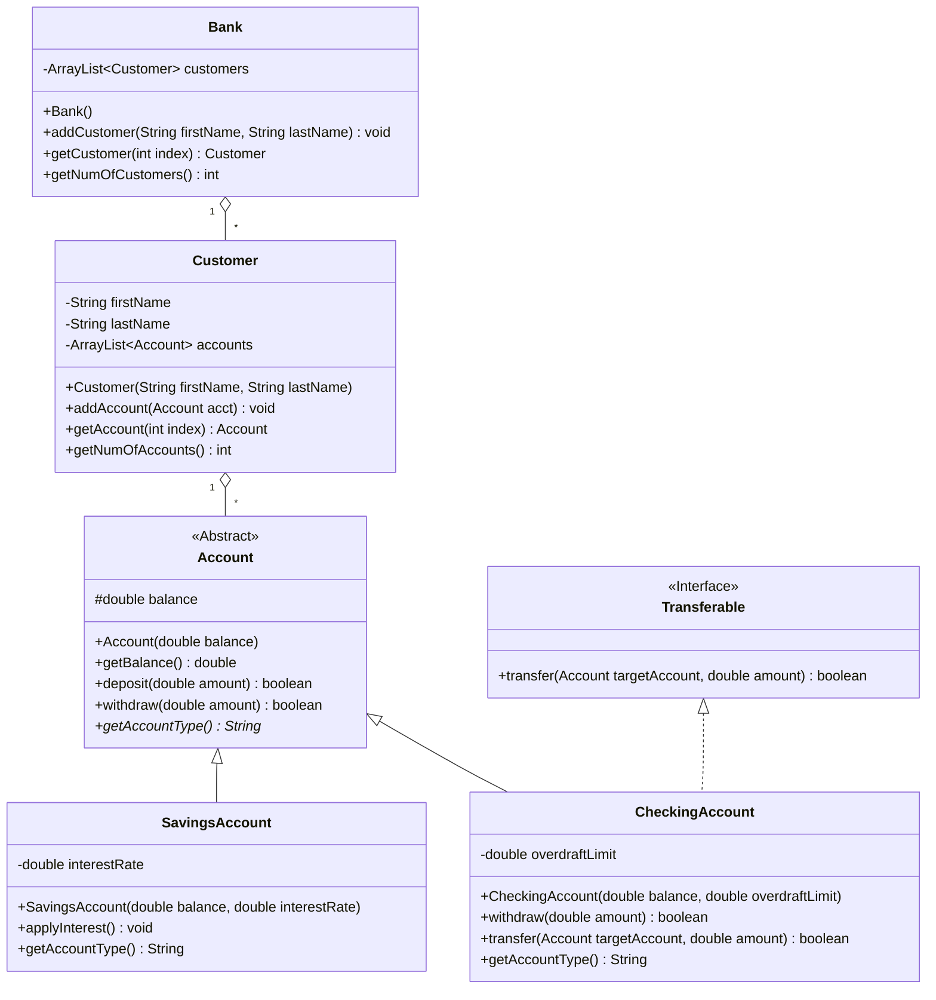

```markdown
# Program Review: Simple Banking ATM System

## Overview
The Simple Banking ATM System is a Java-based console application designed to manage bank customers and their accounts. This project demonstrates core Object-Oriented Programming (OOP) principles alongside Java data structures and utility classes.

---

## 1. Abstract Class
An abstract class is a class declared using the `abstract` keyword. It provides a common template and shared structure for related classes and can contain abstract methods that must be implemented by its concrete subclasses.

In the Simple Banking System, `Account` is an abstract class that defines common attributes and methods for all types of bank accounts.

```java
public abstract class Account {
    protected double balance;

    public Account(double balance) {
        if (Double.isNaN(balance) || Double.isInfinite(balance) || balance < 0) {
            throw new IllegalArgumentException("Initial balance must be a finite, non-negative amount.");
        }
        this.balance = balance;
    }

    public double getBalance() {
        return balance;
    }

    public boolean deposit(double amount) { ... }
    public boolean withdraw(double amount) { ... }

    // Abstract method
    public abstract String getAccountType();
}

```

The `Account` class cannot be instantiated directly using `new Account()`. Its subclasses must provide an implementation for the abstract method `getAccountType()`.

---

## 2. Interface

An interface is an abstract contract in Java that specifies a set of methods a class must implement. It allows unrelated classes to share common behaviors.

In this system, the `Transferable` interface defines a transaction capability for accounts that support fund transfers.

```java
public interface Transferable {
    boolean transfer(Account targetAccount, double amount);
}

```

The `CheckingAccount` class implements `Transferable`, providing the specific logic to transfer funds to another account with proper overdraft and balance validation.

---

## 3. Inheritance

Inheritance allows a subclass to acquire accessible attributes and methods from a superclass using the `extends` keyword, promoting code reuse.

In the Simple Banking System, `SavingsAccount` and `CheckingAccount` inherit from the abstract class `Account`.

```java
public class SavingsAccount extends Account {
    private double interestRate;

    public SavingsAccount(double balance, double interestRate) {
        super(balance); // Calls the parent class (Account) constructor
        this.interestRate = interestRate;
    }

    public void applyInterest() {
        double interest = balance * interestRate;
        deposit(interest);
    }

    @Override
    public String getAccountType() {
        return "Savings Account (Interest Rate: " + (interestRate * 100) + "%)";
    }
}

```

The `SavingsAccount` inherits `balance`, `deposit()`, and `withdraw()` from `Account`, while adding its own unique attribute `interestRate` and method `applyInterest()`. `CheckingAccount` follows a similar inheritance structure.

---

## 4. Polymorphism

Polymorphism allows objects of different classes to be treated as objects of a common superclass, while executing their own specific implementations of overridden methods at runtime.

### Runtime Polymorphism (Method Overriding)

`CheckingAccount` overrides the `withdraw()` method from `Account` to allow withdrawals beyond the current balance up to an overdraft limit:

```java
@Override
public boolean withdraw(double amount) {
    if (amount > 0 && (balance + overdraftLimit) >= amount) {
        balance -= amount;
        return true;
    }
    return false;
}

```

Both `SavingsAccount` and `CheckingAccount` override `getAccountType()` to provide their respective account details.

### Polymorphic Collection

Polymorphism is demonstrated when `Customer` stores multiple account types in a collection declared with the superclass reference `Account`:

```java
for (int j = 0; j < c.getNumOfAccounts(); j++) {
    Account acc = c.getAccount(j);
    System.out.println("  -> Account [" + j + "] (" + acc.getAccountType() + ") Balance: $" + acc.getBalance());
}

```

Even though `acc` is of type `Account`, Java dynamically invokes the correct `getAccountType()` method based on whether the actual object is a `SavingsAccount` or a `CheckingAccount`.

---

## 5. ArrayList

`ArrayList` is a dynamic, resizable collection in Java that stores objects and automatically manages memory size as elements are added or removed.

In this system, `Bank` uses an `ArrayList<Customer>` to store registered customers, and `Customer` uses an `ArrayList<Account>` to manage multiple accounts per customer.

```java
import java.util.ArrayList;

public class Customer {
    private String firstName;
    private String lastName;
    private final ArrayList<Account> accounts;

    public Customer(String firstName, String lastName) {
        this.firstName = firstName;
        this.lastName = lastName;
        this.accounts = new ArrayList<>();
    }

    public void addAccount(Account acct) {
        accounts.add(acct);
    }
}

```

Unlike primitive arrays, `ArrayList` allows customers to open an arbitrary number of accounts dynamically.

---

## 6. Scanner

`Scanner` is a utility class from `java.util` used to capture user input from standard input (keyboard).

In `Main.java`, `Scanner` processes user choices from the menu and inputs amounts for account creation, deposits, and withdrawals:

```java
import java.util.Scanner;

Scanner scanner = new Scanner(System.in);
System.out.print("Enter First Name: ");
String firstName = scanner.nextLine().trim();

System.out.print("Enter Initial Balance: ");
double initialBalance = Double.parseDouble(scanner.nextLine().trim());

```

The application includes validation helpers (`readInt` and `readAmount`) to handle invalid inputs safely without crashing the program.

---

## Conclusion

The Simple Banking ATM System effectively demonstrates fundamental Java concepts. The abstract class `Account` sets a unified structure, while `Transferable` provides a functional interface. `SavingsAccount` and `CheckingAccount` use inheritance and polymorphism to implement distinct banking behaviors. Finally, `ArrayList` and `Scanner` enable dynamic data management and interactive console execution.

---

## Class Diagram



```

```
